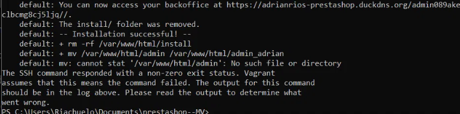
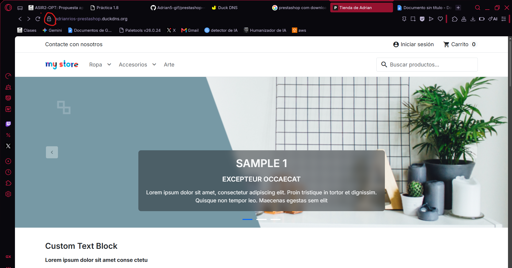
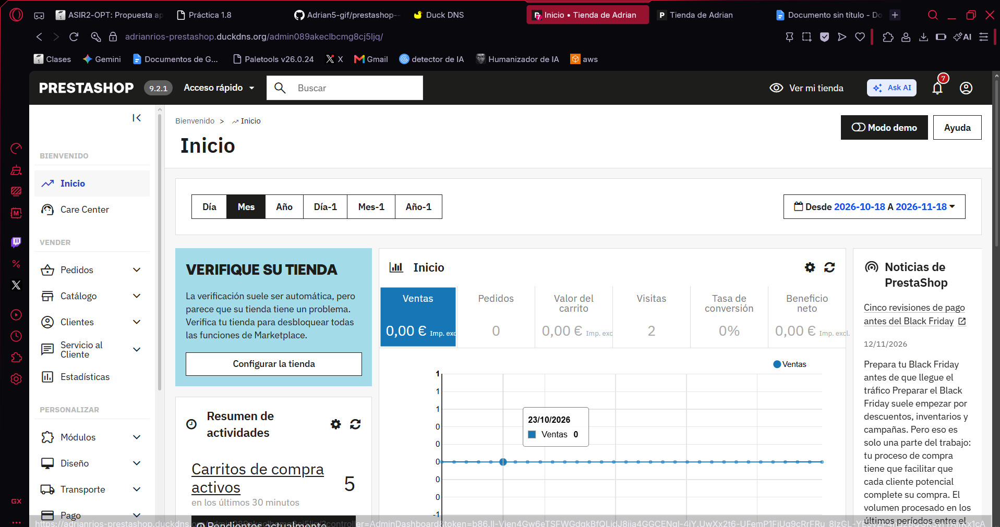
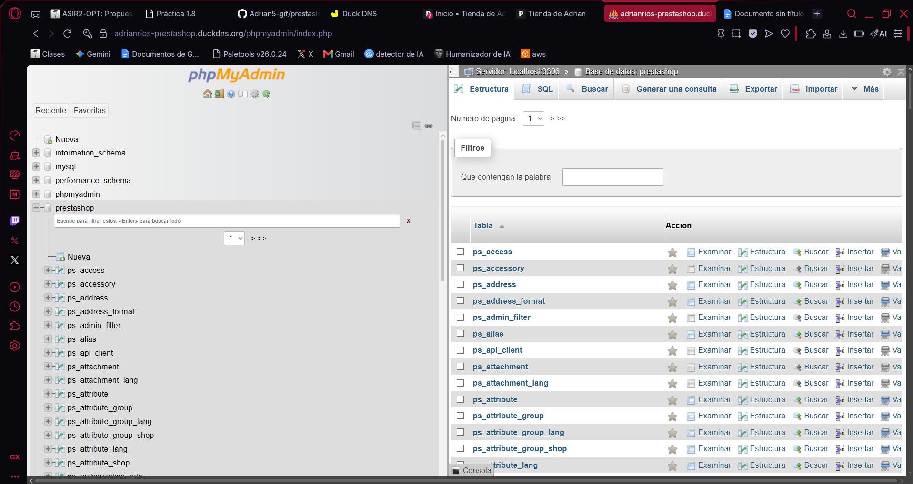
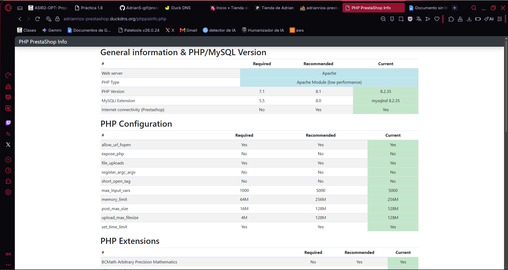
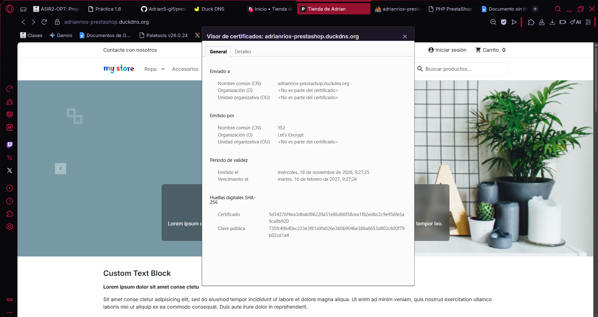
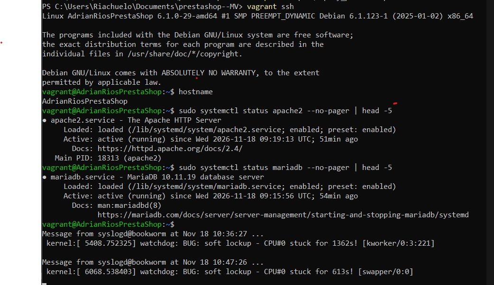

# Implantación de PrestaShop en una máquina virtual

Práctica de Implantación de Aplicaciones Web (2º ASIR)
Adrián Ríos Mendoza

Tienda: https://adrianrios-prestashop.duckdns.org

## Índice

1. [Introducción](#1-introducción)
2. [Aclaraciones y accesos](#2-aclaraciones-y-accesos)
3. [Cómo es la infraestructura](#3-cómo-es-la-infraestructura)
4. [Ficheros del repositorio](#4-ficheros-del-repositorio)
5. [Vagrantfile](#5-vagrantfile)
6. [Pila LAMP](#6-pila-lamp)
7. [phpMyAdmin](#7-phpmyadmin)
8. [Certificado HTTPS](#8-certificado-https)
9. [Instalación de PrestaShop](#9-instalación-de-prestashop)
10. [Cómo ponerlo en marcha](#10-cómo-ponerlo-en-marcha)
11. [Comprobaciones](#11-comprobaciones)
12. [Problemas que he tenido](#12-problemas-que-he-tenido)
13. [Conclusión](#13-conclusión)

## 1. Introducción

En esta práctica he montado una tienda online con **PrestaShop**, que es una aplicación para crear tiendas en Internet.

Lo he hecho en una **máquina virtual con Debian 12**. La máquina se crea con **Vagrant** y todo se instala solo con unos **scripts de Bash**:

- La pila **LAMP**: Linux, Apache, MariaDB y PHP.
- **phpMyAdmin**, para ver la base de datos desde el navegador.
- Un **certificado HTTPS** de Let's Encrypt.
- **PrestaShop 9.2.1**, que es la última versión, instalado desde la línea de comandos.
- **PhpPsInfo**, una herramienta de PrestaShop para comprobar que el servidor cumple los requisitos.

## 2. Aclaraciones y accesos

### Por qué Debian y no Ubuntu

En otras prácticas, las máquinas con Ubuntu se me quedaban colgadas al instalar la base de datos. Con Debian 12 y MariaDB me funciona bien, y todo lo que pide la práctica es igual.

### Por qué el zip de PrestaShop no está en el repositorio

Desde la versión 9, PrestaShop ya no se puede descargar desde GitHub: hay que hacerlo desde su web rellenando un formulario. Además, el zip pesa 129 MB y GitHub no deja subir ficheros de más de 100 MB.

Para volver a montar la práctica hay que descargarlo de [prestashop.com](https://www.prestashop.com) y guardarlo en la carpeta del proyecto como `prestashop_9.2.1.zip`.

### Por qué falta el token de DuckDNS

El token es como una contraseña, así que no lo he subido. Para volver a montar la práctica hace falta una cuenta de DuckDNS y guardar el token en `scripts/duckdns_token.txt`.

### Por qué la web solo funciona en mi PC

El dominio apunta a `127.0.0.1`, que es "este mismo ordenador". Desde mi PC, los puertos 80 y 443 llevan a la máquina virtual. Desde otro ordenador no se puede entrar, porque la máquina no está en Internet. Por eso he puesto capturas de todo.

### Accesos

| Qué | Dirección | Usuario | Contraseña |
|---|---|---|---|
| Tienda | https://adrianrios-prestashop.duckdns.org | — | — |
| Panel de administración | https://adrianrios-prestashop.duckdns.org/admin089akeclbcmg8cj5ljq/ | adrian5@iesalbarregas.es | Adrian.Tienda2026 |
| phpMyAdmin | https://adrianrios-prestashop.duckdns.org/phpmyadmin | pma_admin | pma_password |
| PhpPsInfo | https://adrianrios-prestashop.duckdns.org/phppsinfo.php | prestashop | prestashop |

La carpeta del panel de administración tiene un nombre raro (`admin089akeclbcmg8cj5ljq`) porque el instalador de PrestaShop le pone letras al azar por seguridad. Si se vuelve a instalar, saldrá otro nombre distinto.

Las contraseñas son de prueba, solo para la práctica. Están en el fichero `scripts/.env`.

## 3. Cómo es la infraestructura

Es una sola máquina:

| Dato | Valor |
|---|---|
| Nombre | AdrianRiosPrestaShop |
| Sistema | Debian 12 |
| Memoria | 2 GB (PrestaShop necesita al menos 2 GB) |
| Puertos | El 80 y el 443 de mi PC van a la máquina |
| Dominio | adrianrios-prestashop.duckdns.org |

El dominio es gratis, de **DuckDNS**, y apunta a `127.0.0.1` (mi propio PC). Desde mi PC, los puertos 80 y 443 llevan a la máquina virtual.

## 4. Ficheros del repositorio

```
Vagrantfile                    -> crea la máquina
conf/
  000-default.conf             -> configuración de Apache
scripts/
  .env                         -> todas las variables
  install_lamp.sh              -> instala Apache, MariaDB y PHP
  install_phpmyadmin.sh        -> instala phpMyAdmin
  setup_letsencrypt_https.sh   -> pone el HTTPS
  deploy_prestashop.sh         -> instala PrestaShop
img/                           -> capturas
```

En el `.env` están todas las variables: el dominio, las contraseñas, el nombre de la tienda… Todos los scripts lo leen, así que si quiero cambiar algo, solo lo cambio ahí.

Hay dos ficheros que **no he subido** a GitHub (están en el `.gitignore`):

- `scripts/duckdns_token.txt`: el token de DuckDNS, que es como una contraseña.
- El zip de PrestaShop: pesa 129 MB y GitHub no deja subir ficheros de más de 100 MB.

## 5. Vagrantfile

El Vagrantfile crea la máquina con **Debian 12**, le pone el nombre `AdrianRiosPrestaShop`, le da **2 GB de memoria** y pasa los puertos 80 y 443 de mi PC a la máquina.

Después ejecuta los scripts en este orden:

1. `install_lamp.sh`
2. `install_phpmyadmin.sh`
3. `setup_letsencrypt_https.sh`
4. `deploy_prestashop.sh`

## 6. Pila LAMP

Script: `install_lamp.sh`

1. Instala **Apache**, **MariaDB** y **PHP**, con las extensiones que necesita PrestaShop:
   ```bash
   apt-get install -y apache2 mariadb-server unzip curl \
     php libapache2-mod-php php-mysql php-cli \
     php-curl php-gd php-intl php-mbstring php-xml php-zip \
     php-bcmath php-imagick php-memcached
   ```
2. Activa los módulos de Apache que recomienda PrestaShop: `rewrite` (para las URL amigables), `headers` y `env`.
3. Pone la configuración de Apache (`conf/000-default.conf`). Lo importante es `AllowOverride All`, que deja que PrestaShop use sus ficheros `.htaccess`:
   ```apache
   <Directory /var/www/html>
       AllowOverride All
   </Directory>
   ```
4. Cambia el `php.ini` con los valores que recomienda PrestaShop:

   | Opción | Valor |
   |---|---|
   | memory_limit | 256M |
   | max_input_vars | 5000 |
   | post_max_size | 128M |
   | upload_max_filesize | 128M |
   | expose_php | Off |

## 7. phpMyAdmin

Script: `install_phpmyadmin.sh`

1. Contesta antes las preguntas del instalador con `debconf-set-selections`, para que se instale sin pararse.
2. Instala **phpMyAdmin**.
3. Crea un usuario (`pma_admin`) para poder entrar.

Se entra desde https://adrianrios-prestashop.duckdns.org/phpmyadmin

## 8. Certificado HTTPS

Script: `setup_letsencrypt_https.sh`

Es lo mismo que hice en la práctica del balanceador.

Let's Encrypt normalmente comprueba que el dominio es tuyo **entrando a tu servidor por Internet**, pero mi máquina está en mi portátil y no se puede entrar desde Internet. Por eso lo compruebo **por DNS**:

1. Certbot usa el **token de DuckDNS** para escribir un código en el DNS del dominio (un registro **TXT**).
2. Espera 60 segundos a que DuckDNS lo publique.
3. Let's Encrypt consulta el DNS, ve el código y sabe que el dominio es mío.

Para esto uso el plugin **`certbot-dns-duckdns`**. Certbot también configura Apache solo y redirige todo de `http://` a `https://`.

## 9. Instalación de PrestaShop

Script: `deploy_prestashop.sh`

1. **Crea la base de datos** `prestashop` y el usuario `ps_user`.
2. **Vacía** la carpeta `/var/www/html`.
3. **Descomprime PrestaShop.** Desde la versión 9, PrestaShop solo se puede descargar desde su web, rellenando un formulario. Por eso lo descargué en mi PC y lo puse en la carpeta del proyecto. La máquina lo coge de ahí, porque esa carpeta se comparte con la máquina como `/vagrant`.
   El zip trae dentro otro zip, `prestashop.zip`, que es la aplicación. Ese es el que se descomprime en `/var/www/html`.
4. **Descarga PhpPsInfo** de GitHub, para comprobar los requisitos del servidor.
5. Cambia el dueño de los ficheros a `www-data` (el usuario de Apache).
6. **Instala PrestaShop desde la línea de comandos**, con el instalador `index_cli.php`:
   ```bash
   php index_cli.php \
     --domain="$DOMAIN" \
     --db_server=localhost \
     --db_name="$PS_DB_NAME" \
     --db_user="$PS_DB_USER" \
     --db_password="$PS_DB_PASSWORD" \
     --prefix=ps_ \
     --name="$PS_SHOP_NAME" \
     --email="$PS_ADMIN_EMAIL" \
     --password="$PS_ADMIN_PASSWORD" \
     --language="$PS_LANGUAGE" \
     --country="$PS_COUNTRY" \
     --ssl=1
   ```

   | Opción | Para qué sirve |
   |---|---|
   | `--domain` | El dominio de la tienda |
   | `--db_server`, `--db_name`, `--db_user`, `--db_password` | Los datos de la base de datos |
   | `--prefix` | Todas las tablas empiezan por `ps_` |
   | `--name` | El nombre de la tienda |
   | `--email` y `--password` | El usuario del panel de administración |
   | `--language` y `--country` | Español y España |
   | `--ssl=1` | Que la tienda use HTTPS |

   Al terminar, el propio instalador **borra la carpeta `install`** y **cambia el nombre de la carpeta `admin`** por uno con letras al azar. Esto es por seguridad: así nadie puede adivinar dónde está el panel de administración.

## 10. Cómo ponerlo en marcha

1. Descargar PrestaShop de su web y guardarlo en la carpeta del proyecto como `prestashop_9.2.1.zip`.
2. Guardar el token de DuckDNS (en PowerShell):
   ```powershell
   Set-Content -Path scripts\duckdns_token.txt -Value "TOKEN" -Encoding ascii
   ```
3. Crear la máquina:
   ```bash
   vagrant up
   ```
4. Abrir https://adrianrios-prestashop.duckdns.org

## 11. Comprobaciones

### Instalación de PrestaShop

El instalador termina con "Installation successful" y dice dónde está el panel de administración.



### La tienda

La tienda funciona por HTTPS.



### Panel de administración

Arriba se ve que es la versión **9.2.1**.



### phpMyAdmin

La base de datos `prestashop` con todas las tablas de la tienda.



### PhpPsInfo

Todo sale en verde: el servidor cumple todos los valores recomendados por PrestaShop.



### Certificado

Certificado de Let's Encrypt válido para `adrianrios-prestashop.duckdns.org`.



### Servicios

Apache y MariaDB funcionando dentro de la máquina.



## 12. Problemas que he tenido

**Ubuntu se colgaba.** La guía usa Ubuntu Server, pero en la práctica del balanceador ya vi que en mi portátil las máquinas con Ubuntu se quedaban colgadas al instalar la base de datos. Por eso he usado Debian 12 con MariaDB, que me funciona bien.

**No se podía descargar PrestaShop desde el script.** Desde la versión 9 ya no está en GitHub y en la web hay que rellenar un formulario. Lo descargué a mano y lo puse en la carpeta del proyecto.

**El script fallaba al final.** Intentaba borrar la carpeta `install` y cambiar el nombre de `admin`, pero el instalador de PrestaShop 9 ya lo hace solo. Quité esas líneas del script.

## 13. Conclusión

Con un solo `vagrant up` se instala todo: la pila LAMP, phpMyAdmin, el HTTPS y PrestaShop.

Lo que más me ha gustado es instalar PrestaShop desde la línea de comandos, porque así no hace falta pasar por el asistente del navegador y se puede automatizar en el script.

Al final la tienda funciona por HTTPS, y con PhpPsInfo he comprobado que el servidor cumple todo lo que pide PrestaShop.
